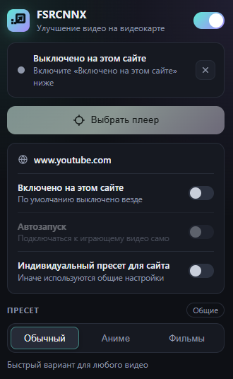

# FSRCNNX — улучшение видео

Расширение для Chrome, которое в реальном времени улучшает любое HTML5-видео
прямо на вашей видеокарте:

- **Увеличение нейросетью** — шейдеры [FSRCNNX](https://github.com/igv/FSRCNN-TensorFlow)
  (из плеера mpv) увеличивают видео в 2 раза и дорисовывают детали, затем
  картинка подгоняется под размер плеера.
- **Удвоение кадров ×2** — нейросеть [Framegen](https://github.com/MONZikWasTaken/Framegen)
  дорисовывает промежуточный кадр между каждыми двумя кадрами: 24 кадра/с
  превращаются в 48.

Обе функции включаются независимо. Всё работает локально через WebGPU, видео
никуда не отправляется.


## Требования

- Chrome 130 или новее с включённым графическим ускорением (WebGPU).
- Страница должна быть открыта по **https**: на http WebGPU недоступен.
- Для ×2 лучше всего монитор 120/144 Гц; на 60 Гц движение будет менее ровным.

## Установка

1. Откройте `chrome://extensions` и включите «Режим разработчика».
2. Нажмите «Загрузить распакованное расширение» и выберите папку `extension`.

Файлы Framegen (`extension/vendor/framegen`) уже лежат в репозитории. Если их
нужно скачать заново, выполните `python tools/vendor_framegen.py`: скрипт
берёт версию v1.5.3 с GitHub и сверяет SHA-256 из `vendor/framegen/VERSION`.

## Как пользоваться



1. Откройте страницу с видео и нажмите на значок расширения.
2. Включите «Включено на этом сайте»: по умолчанию расширение выключено
   на всех сайтах, а включённые запоминаются.
3. «Выбрать плеер» → наведите курсор на видео и кликните (Esc — отмена).
   Можно включить «Автозапуск», чтобы расширение само подключалось к
   играющему видео на этом сайте.
4. Выберите пресет («Обычный», «Аниме», «Фильмы») и при желании включите
   «Удвоение кадров ×2».

У каждой настройки в попапе есть всплывающая подсказка — наведите курсор на
строку.

<br clear="right">

### Основные настройки

| Настройка | Что делает |
|---|---|
| Увеличение нейросетью | FSRCNNX ×2. Для видео 1440p и больше (по короткой стороне) не применяется. |
| Удвоение кадров ×2 | Промежуточные кадры. На смене сцены промежуточный кадр не рисуется. |
| Пропускать повторы кадров | Повторяющийся кадр (аниме «по двойкам») не обрабатывается заново, между повторами промежуточный кадр не рисуется. По умолчанию выключено. |
| Сравнение A/B | Слева исходное видео, справа результат всей обработки. |
| Показывать панель (HUD) | Панель поверх видео с показателями: частота вывода, время видеокарты, нагрузка ×2, задержка, пропуски кадров. |
| Включено на этом сайте | По умолчанию расширение выключено везде; включённые сайты запоминаются. |
| Индивидуальный пресет для сайта | Хранить пресет и параметры отдельно для текущего сайта. Если выключено, сайт использует общие настройки, и их изменение сразу действует на нём. |

В «Дополнительно» — модель (8 — быстрая, 16 — качественнее, 16 Аниме — для
рисованной графики), резкость, подавление ореолов и итоговое масштабирование.

## Ограничения

- Видео с DRM (Netflix и т.п.) и видео с другого сайта без разрешения CORS
  обработать нельзя: браузер не даёт доступ к их кадрам.
- ×2 добавляет задержку картинки относительно звука около 30 мс.
- Если видеокарта не успевает, ×2 отключается сам; включится снова после
  изменения любой настройки.
- Встроенные кнопки и субтитры `<video>` (не плеера сайта) оказываются под
  картинкой расширения.

## Лицензии

- Код расширения — MIT (`LICENSE`).
- Шейдеры FSRCNNX от igv — LGPL-3.0 (`extension/shaders/COPYING.LESSER`,
  `extension/shaders/COPYING`).
- Шейдер `FSRCNNX_x2_16-0-4-1_anime_enhance.glsl` — из релиза `1.1_distort`
  [HelpSeeker/FSRCNN-TensorFlow](https://github.com/HelpSeeker/FSRCNN-TensorFlow),
  MIT (`extension/shaders/LICENSE.anime_enhance`).
- Код Framegen — MIT (`extension/vendor/framegen/LICENSE`).
- **Веса нейросети Framegen — только для личного некоммерческого
  использования** (`extension/vendor/framegen/WEIGHTS_LICENSE.md`).

## Для разработки

Расширение написано на обычном JavaScript без сборки: скрипты подключаются
списком `CONTENT_FILES` в `src/background/service-worker.js`, порядок важен.

```
extension/
  manifest.json
  src/background/service-worker.js   внедрение скриптов, автозапуск, значок
  src/shared/settings.js             настройки, пресеты, общие функции
  src/popup/                         попап
  src/content/
    gpu.js                           общее устройство WebGPU, замер времени
    mpv-hook.js, wgsl-hook.js        разбор mpv-шейдеров и перевод в WGSL
    wgsl-passes.js, renderer.js      конвертация, CAS, вывод на холст
    framegen.js, interpolator.js     загрузка Framegen, промежуточные кадры
    frame-diff.js                    детектор повторов и смены сцены
    frame-scheduler.js               расписание вывода кадров для ×2
    budget-guard.js                  отключение ×2 при перегрузке
    interp-controller.js             связка ×2 для одного видео
    session.js, overlay.js           сессия видео, холст и HUD
    main.js, picker.js, video-finder.js
  vendor/framegen/                   сторонний runtime и веса (без изменений)
tools/
  parity/                            тесты рендера
  vendor_framegen.py                 загрузка файлов Framegen
  make_icons.py                      генерация иконок
```

### Тесты

Нужны Python 3 с Pillow и установленный Chrome.

```
python tools/parity/run_parity.py          # сравнение WebGPU с эталонным WebGL2-рендером
python tools/parity/run_parity.py --gpu    # то же на настоящей видеокарте (+ время кадра)
python tools/parity/run_parity.py --page "framegen?scale=4&shift=8"   # проверка ×2 и детектора
```

Страницы тестов работают только по http (скрипт сам поднимает сервер). Чтобы
открыть их вручную, выполните `python -m http.server` в корне репозитория и
зайдите на `http://127.0.0.1:8000/tools/parity/webgpu.html`.

### Публикация в Chrome Web Store

`python tools/package.py` собирает `dist/fsrcnnx-upscaler-chrome-<версия>.zip`
и проверяет лимиты манифеста.
